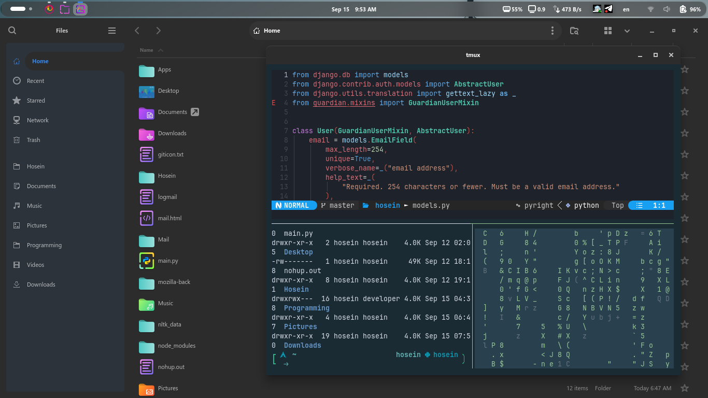

# Dotfiles

Personal Linux desktop and terminal configuration.

- [Zsh setup and usage](zsh/README.md): Oh My Zsh, plugins, and the Syhomadara prompt.
- [Konsole setup and usage](konsole/README.md): terminal palette, Persian rendering, and font installation.

The directory layout mirrors paths under your home directory. Run the installation commands in each guide from the repository root. Back up existing configuration before copying it.

## Screenshot

